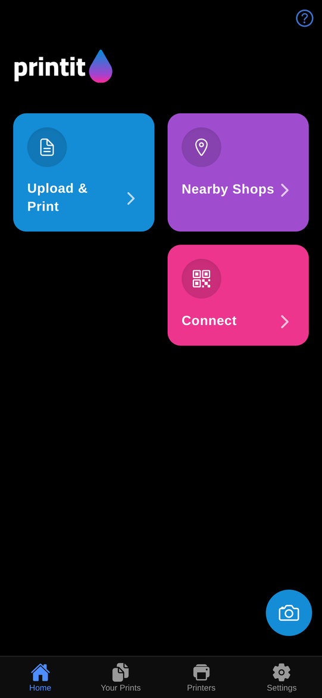
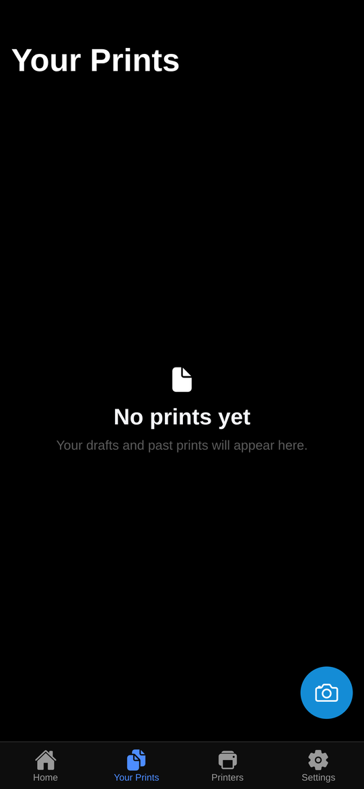
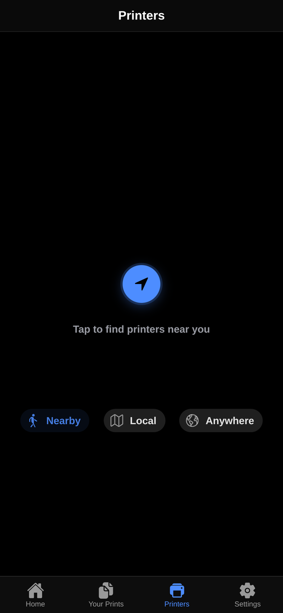
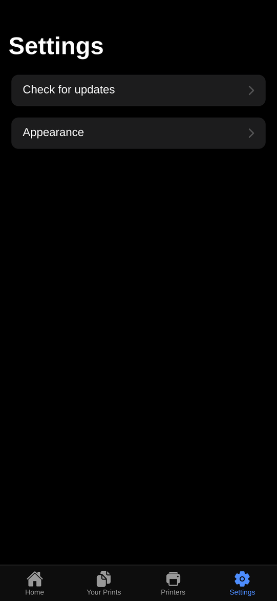
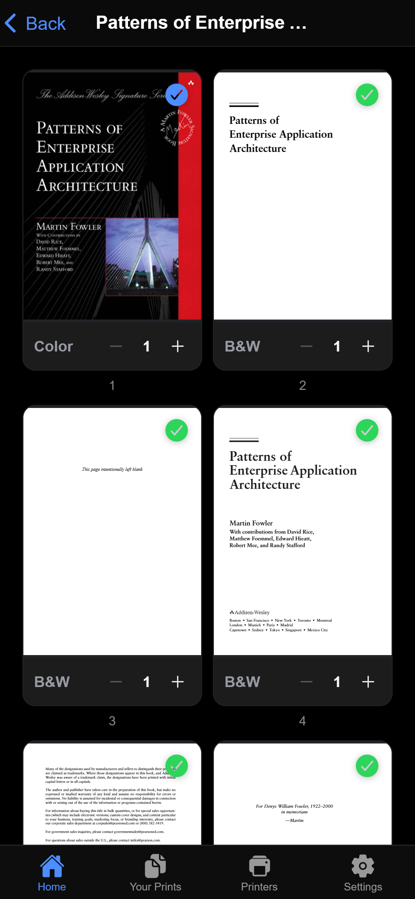
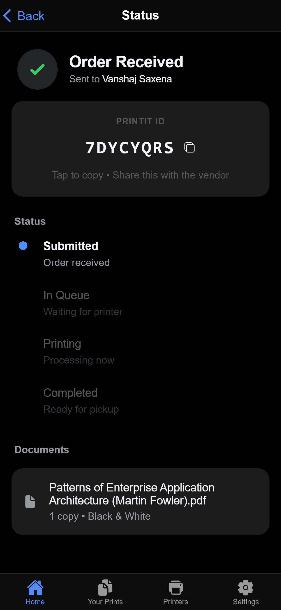
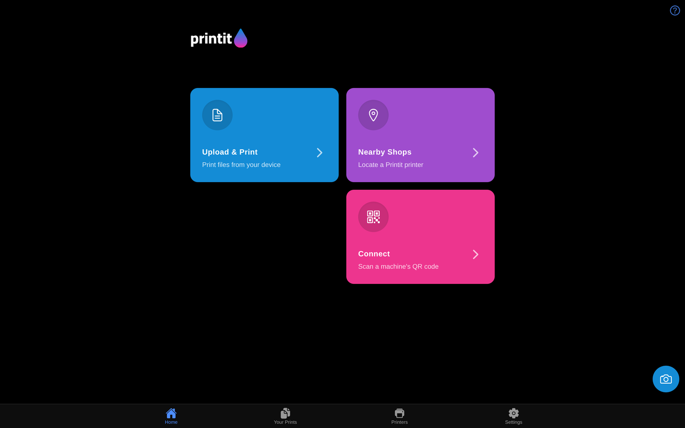
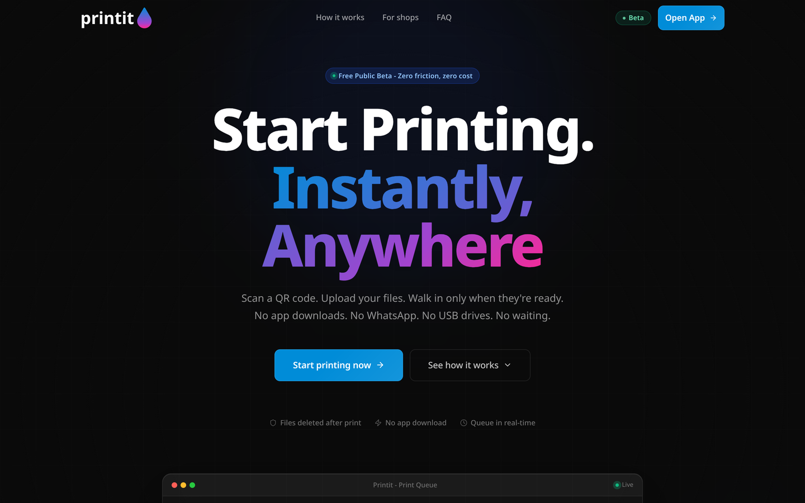

# printit-pwa

The web app students used to send documents to a print shop with Printit. It ran at app.printit.ink as an installable progressive web app, so nobody had to download anything from an app store.

Printit let students send documents to a print shop from their phone. They opened this app, picked a shop by scanning the QR code on its counter or from a list of nearby shops, uploaded PDFs and chose color and copies for each page. The shop's Windows PC printed the order and reported progress back to the student's phone as it happened.

Printit is shelved. I built it between August 2025 and July 2026 and I'm not maintaining it any more.

## Screenshots

<table>
  <tr>
    <td></td>
    <td></td>
    <td></td>
    <td></td>
  </tr>
  <tr>
    <td>Home</td>
    <td>Your Prints</td>
    <td>Printers</td>
    <td>Settings</td>
  </tr>
</table>

These were taken signed out, so the lists are empty. The two below come from the app's install screen (they're in `public/screenshots`) and show an actual order: choosing color and copies for each page, then the order's status after it was sent to a shop.

<table>
  <tr>
    <td></td>
    <td></td>
  </tr>
  <tr>
    <td>Print options</td>
    <td>Order status</td>
  </tr>
</table>

On a wider screen:



And the old printit.ink landing page, which lived in a separate repository:



## How it fits with the rest of Printit

| Repository | Part |
| --- | --- |
| [printit-cloud](https://github.com/VanshajSaxena/printit-cloud) | The API: shops, orders, file storage, live notifications |
| printit-pwa (this one) | The web app students used on their phones |
| [printit-desktop](https://github.com/VanshajSaxena/printit-desktop) | The Electron app shops ran on their Windows PC |
| [win-print-service](https://github.com/VanshajSaxena/win-print-service) | The Windows print service the shop app talks to |

The app talks only to printit-cloud. It creates an order, asks the API for signed upload URLs and uploads the PDFs straight to Cloudflare R2. Then it follows the order over Socket.IO while the shop's app prints it. It also shows whether a shop is online.

I wrote about the project at [vanshajsaxena.com/projects/printit](https://vanshajsaxena.com/projects/printit/). The posts on [the shop app's state machine](https://vanshajsaxena.com/posts/electron-state-machine/) and [the Windows print spooler](https://vanshajsaxena.com/posts/windows-print-spooler/) cover the other end of an order.

## What it does

- Connect to a shop by scanning its QR code with the camera (ZXing), or find one from the Printers tab, which uses the phone's location to search within 1 km, within 5 km, or anywhere.
- Pick PDFs, see a thumbnail of every page (pdf.js), and set color or black and white and the number of copies per page. Encrypted PDFs are detected before upload.
- Receive PDFs shared from other apps. The app registers as a share target, and the service worker takes the shared files and hands them to the app.
- Follow an order from Submitted through In Queue and Printing to Completed. Drafts and past prints are kept on the device in IndexedDB.
- Choose a light, dark or system theme and the iOS or Material look, and apply app updates from Settings when a new service worker is waiting.

Stack: React 19 with Ionic 8, TypeScript, Vite, Tailwind CSS 4, vite-plugin-pwa with a custom service worker, TanStack Query with openapi-fetch, Zustand with idb-keyval, the Socket.IO client, pdf.js, pdf-lib and ZXing. It was hosted on Netlify. The API types in `src/api` are generated from printit-cloud's OpenAPI spec with `yarn api:gen`.

The Capacitor packages and `capacitor.config.ts` came with the Ionic starter. I never built a native Android or iOS app, and the config still has the starter's `appId` (`io.ionic.starter`).

## Running it locally

You need Node.js and Yarn 4 (through Corepack).

```sh
corepack enable
yarn install
```

The API address comes from `VITE_API_BASE_URL`. Netlify set it for each deploy in `netlify.toml`. Locally, put it in `.env.local`, for example pointing at a local [printit-cloud](https://github.com/VanshajSaxena/printit-cloud):

```sh
VITE_API_BASE_URL=http://localhost:3000
```

Then:

```sh
yarn start:dev   # dev server on http://localhost:8100
yarn build       # production build in dist/
```

## License

MIT, see [LICENSE](LICENSE).
